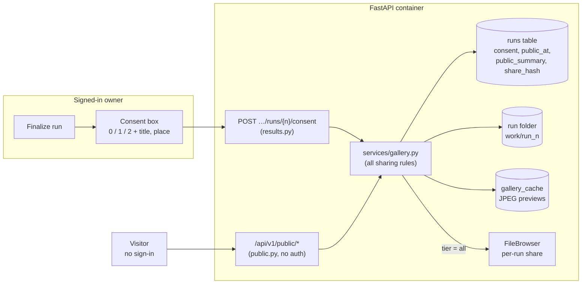
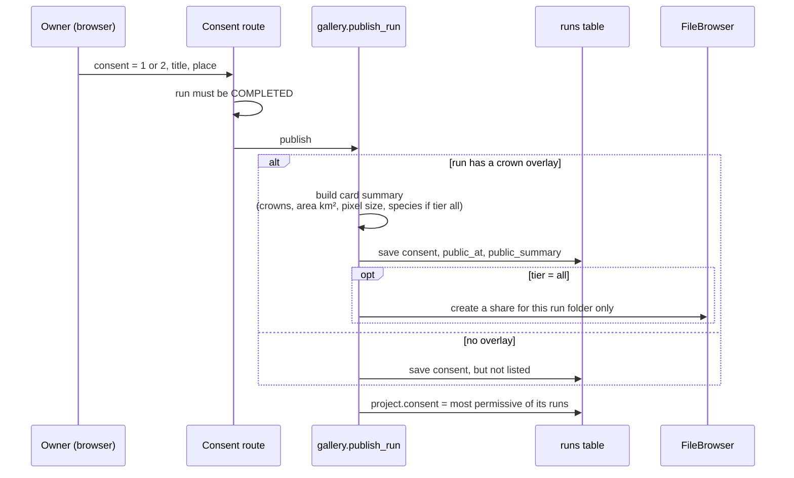
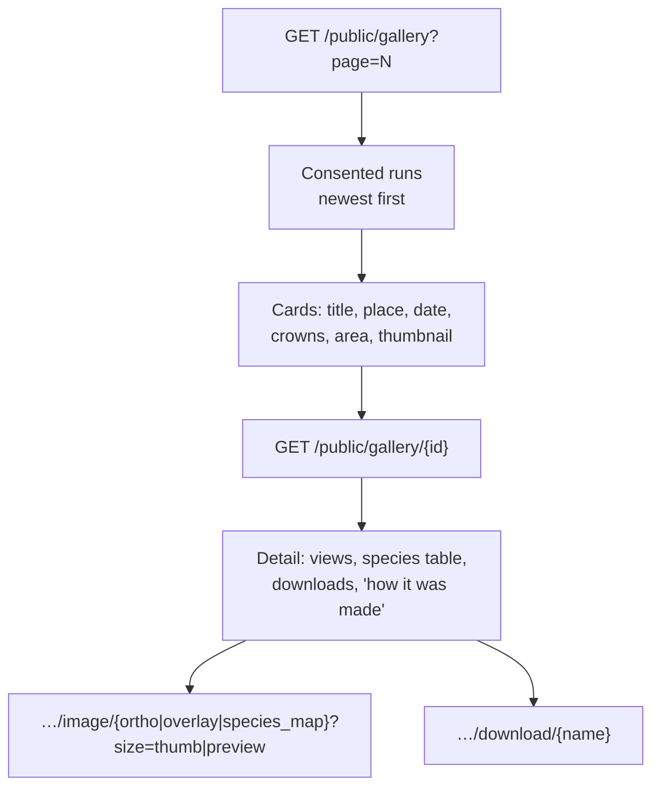

# Public Runs (Gallery)

The public gallery lets anyone, without signing in, browse finished survey runs:
the orthomosaic, the detected tree crowns, and (if allowed) the species map and
result files. It lives at `#/gallery` in the same web app.

A run gets into the gallery only through **owner consent**: after a run is
finalized, its owner answers a sharing question.

Nothing is copied. The gallery reads each run from its own folder,
`projects/<project_id>/work/run_<n>/`.

---

## Architecture

All decisions about what a visitor can see are made in one place,
`code/app/services/gallery.py`. The routes in `code/app/api/v1/public.py` only
call it.

---

## Consent levels (tiers)

Consent is given **per run**, not per project.

| Consent | Tier | Visitor sees |
|---|---|---|
| 0: No | none | Not listed. |
| 1: Yes, all data | `all` | Orthomosaic, crown outlines, species map, species counts, downloads (GeoJSON, KMZ, crown CSV, STAC), FileBrowser link to the run's files |
| 2: Yes, unlabelled only | `crowns` | Orthomosaic, crown outlines, crown GeoJSON. No species names, counts or files link. |

The tier is checked on the server for every image and every download. Hiding a
link in the page is not what keeps species data private.

---

## How a run gets published

- The card numbers are stored in `Run.public_summary`, so the gallery list does
  not have to read rasters on every page load.
- After a relabel and Finalize, the card is rebuilt (`refresh_run_card`).
- **Unpublish:** the owner sets consent to 0 from the run's results view. The run
  leaves the gallery. Its FileBrowser share is **not** revoked,
  so a files link already handed out keeps working.

---

## How a visitor browses

| Route (under `/api/v1/public`) | Returns |
|---|---|
| `GET /gallery` | One page of cards (default 8 per page) |
| `GET /gallery/{id}` | Full detail for one run |
| `GET /gallery/{id}/image/{kind}` | JPEG preview, made on first request and cached in `gallery_cache/` |
| `GET /gallery/{id}/download/{name}` | One file from a fixed list |

Points worth knowing:

- `{id}` is always the run's uuid. Requests never contain a file path, only a
  name from a fixed list.
- Not shared, not allowed for this tier, and missing all return the same `404`.
- No identity is sent or needed; the owner's name and email are never shown.
- Older runs without a species map image get one drawn on first request.

---

## Retention

Retention (`code/scripts/run_retention.py`, run by cron) works per **project**,
using the most permissive consent of its runs:

| Project consent | After the retention window |
|---|---|
| 1 (all) | Kept (if `retain_consent_all`) |
| 2 (unlabelled) | Pruned: species outputs and labels deleted, crowns kept |
| 0 | Deleted |

Known gap: because retention is per project, one fully shared run keeps the
species outputs of the project's other runs on disk too (they stay unpublished).

---

## Where to look

| What | File |
|---|---|
| Sharing rules, tiers, card summary | `code/app/services/gallery.py` |
| Public routes | `code/app/api/v1/public.py` |
| Consent route | `code/app/api/v1/results.py` (`_save_consent`) |
| Consent box and gallery page | `frontend/index.html` (`consentBoxHtml`, `#gal-page`) |
| Retention | `code/scripts/run_retention.py` |
| Settings | `TCP_GALLERY_PAGE_SIZE` |
